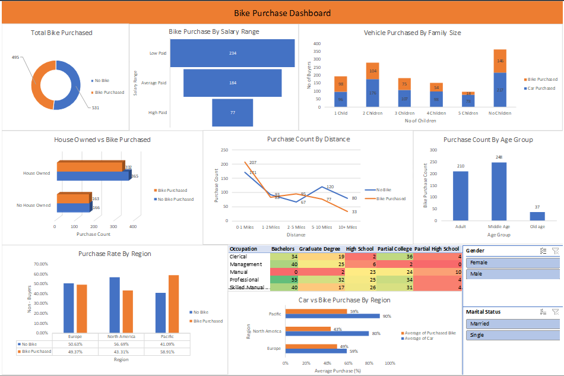

# Bike Purchase Behavior Dashboard (Excel)

An interactive Microsoft Excel business intelligence dashboard analyzing **1,026 customer records** (`495` bike buyers vs. `531` non-buyers) across income brackets, commute distances, age groups, occupations, family size, and global regions.

---

## Project Workflow & Technical Highlights
* **Data Cleaning & Feature Engineering (Power Query & Excel):** Cleaned raw customer demographic and purchase records using **Excel Power Query**—standardizing marital status (`Married`/`Single`), gender labels, and commute distance tiers, while engineering custom calculated columns for **Age Group** (`Adult`, `Middle Age`, `Old Age`) and **Salary Range** (`Low Paid`, `Average Paid`, `High Paid`).
* **Multi-Dimensional Pivot Modeling:** Built dynamic **Pivot Tables** and a conditional-formatted **Occupation × Education Matrix** to uncover demographic purchase patterns.
* **Interactive Visualization & Slicers:** Combined a Donut chart, Funnel chart, stacked/clustered bar & column charts, line trend chart, and synchronized **`Gender`** and **`Marital Status`** slicers for instant segmentation.

---

## Key Insights & Findings
* **Commute Distance Impact:** Short-distance commuters (**`0–1 Miles`**) show the highest bike purchase volume (`207` buyers vs. `171` non-buyers), whereas purchase counts drop steadily beyond `5+` miles.
* **Age & Income Demographics:** **Middle-Aged** customers (`248` purchases) and **Adults** (`210` purchases) account for over `92%` of all bike purchases, with the **Low Paid** (`234`) and **Average Paid** (`184`) segments driving the highest unit volume.
* **Regional Purchase Conversion:** The **Pacific** region leads all territories with a **`58.91%`** bike purchase rate (followed by **Europe** at **`49.37%`** and **North America** at **`43.31%`**).
* **Occupation & Education Patterns:** **Professional** (`55` Bachelors, `32` Graduate Degree) and **Skilled Manual** (`40` Bachelors) roles represent the strongest buyer concentrations.

---

## Dashboard Preview

